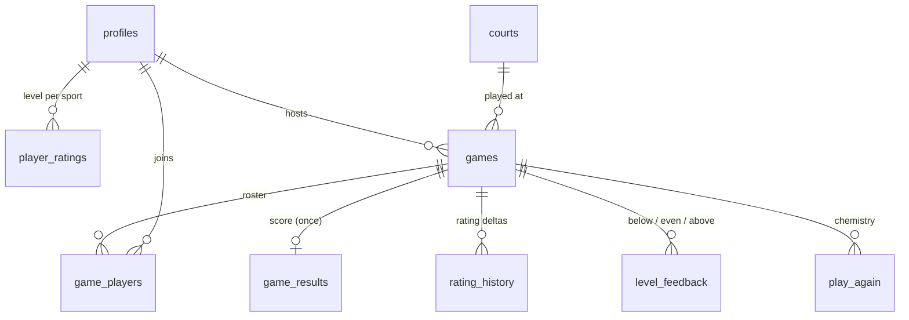

# Fourth Up data model

Fourth Up is a two-sided marketplace: hosts post games, players fill them. Two numbers decide whether it works:

1. **Fill rate.** Does a posted game fill? This depends on liquidity: enough players, at the right level, near the right court, at the right time.
2. **Match quality.** Was the game fun? This depends on how well we know each player's level, and over time on who plays well together.

The schema is built to measure and improve both.

## Entities



| Table | What it stores | Written by |
|---|---|---|
| `profiles` | Name, location, radius, availability, clubs, self-rated level per sport (`sports` jsonb, 1–10) | the player |
| `courts` | Location, court count, members-only / club (e.g. Life Time), **sports hosted** | seed data + players |
| `games` | Host, court, **sport**, singles/doubles, level range, start time, status | `create_game` |
| `game_players` | Roster, join time, no-show flag | `join_game`, the host after the game |
| `player_ratings` | **Learned level per (player, sport)**: `mu` (level), `sigma` (uncertainty), games counted | `submit_result` only |
| `game_results` | Teams and final score, logged once per game | `submit_result` |
| `rating_history` | Each player's level before and after each scored game | `submit_result` |
| `level_feedback` | Each player's verdict on every other player: −1 below, 0 even, +1 above their own level | `submit_feedback` |
| `play_again` | Would you play with this group again? | `submit_feedback` |

Writes to ratings, results and feedback only happen through `security definer` functions, so a client can't edit its own rating. Feedback is private: you can read only what you said.

## How a level is learned

Each player has a level per sport, modeled as a normal distribution: **mu** is our best estimate of their level, and **sigma** is how unsure we are.

**Prior (cold start).** At sign-up a player picks 1–10 per sport. We map that to the sport's scale: pickleball 2.0–8.0 (DUPR-style), tennis 1.5–7.0 (NTRP-style). That becomes mu, with sigma = 0.8, i.e. "probably within about ±0.8."

**Update (each scored game).** When someone logs the score, `submit_result` runs a two-team **TrueSkill** update. TrueSkill is Microsoft's Bayesian rating system for team games:

- Team strength = sum of the players' mu. Total uncertainty c² = Σσ² + n·β², where β is the level gap that gives about 76% win odds (β = 0.4).
- t = (winner strength − loser strength) / c measures how expected the result was.
- Winners move up and losers move down by σ²/c · v(t), where v(t) = φ(t)/Φ(t). An expected win barely moves anyone; an upset moves a lot.
- Every result shrinks sigma (we know more), and a small τ = 0.02 is added back each game so improving players keep moving.

Why TrueSkill rather than Elo: Elo is built for 1v1 and has no notion of uncertainty. TrueSkill handles doubles natively, and a new player (high sigma) moves fast while a veteran (low sigma) is stable. The two-team case has a closed form, so it runs in Postgres in one transaction. `supabase/tests/ratings.test.mjs` checks it against the `ts-trueskill` reference implementation to within 1e-4.

**Guardrails.**
- One game moves a level by at most ±0.5. This stops a fluke, or a sandbagging new account, from swinging a rating.
- Levels are clamped to the sport's scale.
- A score is logged once per game, by a player in that game, after the start time. Teams must be equal size, made of players from the roster.

**Sports on courts.** Each court lists the sports it hosts (existing NJ courts default to pickleball). Court lists, the live player map and recent courts all filter by the selected sport, and a trigger blocks a game whose sport the court doesn't host.

**Matching.** `player_level(player, sport)` returns the learned mu once a player has scored games, and otherwise their self-rating. `games_for_me`, `push_targets` and `fill_supply` all use it, so as people play, matching quietly switches from what they claimed to how they actually performed.

## What's collected but not used yet (the roadmap)

These signals are stored now so there's history when they're needed:

1. **Calibrating self-ratings with `level_feedback`.** If a new player is rated "below" by most opponents, their self-rating was likely inflated. Weight each verdict by the rater's own sigma, and nudge the prior or widen sigma. Start by measuring it: the correlation between average verdict and the first five rating deltas.
2. **Score margin.** Right now 11–9 counts the same as 11–2. A margin-aware model (e.g. scaling the update by points won ÷ total points) learns faster per game.
3. **Ranking by chemistry with `play_again`.** Build a graph of who-wants-to-play-with-whom. Rank `games_for_me` by expected enjoyment: level fit × distance × play-again affinity × the host's show-up rate.
4. **Fill-chance model.** `fillChance` in `lib/util.ts` uses a Poisson model with assumed yes-rates (35% of available players, 4% of others). Replace the constants with observed acceptance rates per court and hour once there are a few hundred pings.
5. **Disputes.** Any player can log the score, first one wins. If disputes show up, require a second player to confirm before ratings update.

## Metrics to watch

| Metric | Where | Healthy |
|---|---|---|
| Fill rate | `app_stats` | > 50%; below that, grow one court cluster at a time |
| Median time to fill | `app_stats` | trending down |
| Show-up rate | `reliability` | > 90% |
| Score-logging rate | `game_results` ÷ full games | > 60%; without it ratings don't learn |
| Rating confidence | average `sigma` of active players | falling over time |
| Level fit | share of `level_feedback` that's "even" | rising as ratings learn |

## Running the tests

```bash
npm install
npm run test:db
```

This runs the ratings migration in an in-process Postgres (PGlite) with PostGIS and auth stubbed. It checks the TrueSkill math against a reference implementation and exercises `submit_result` and `submit_feedback` end to end: validation errors, rating updates, the ±0.5 cap, and private feedback.
